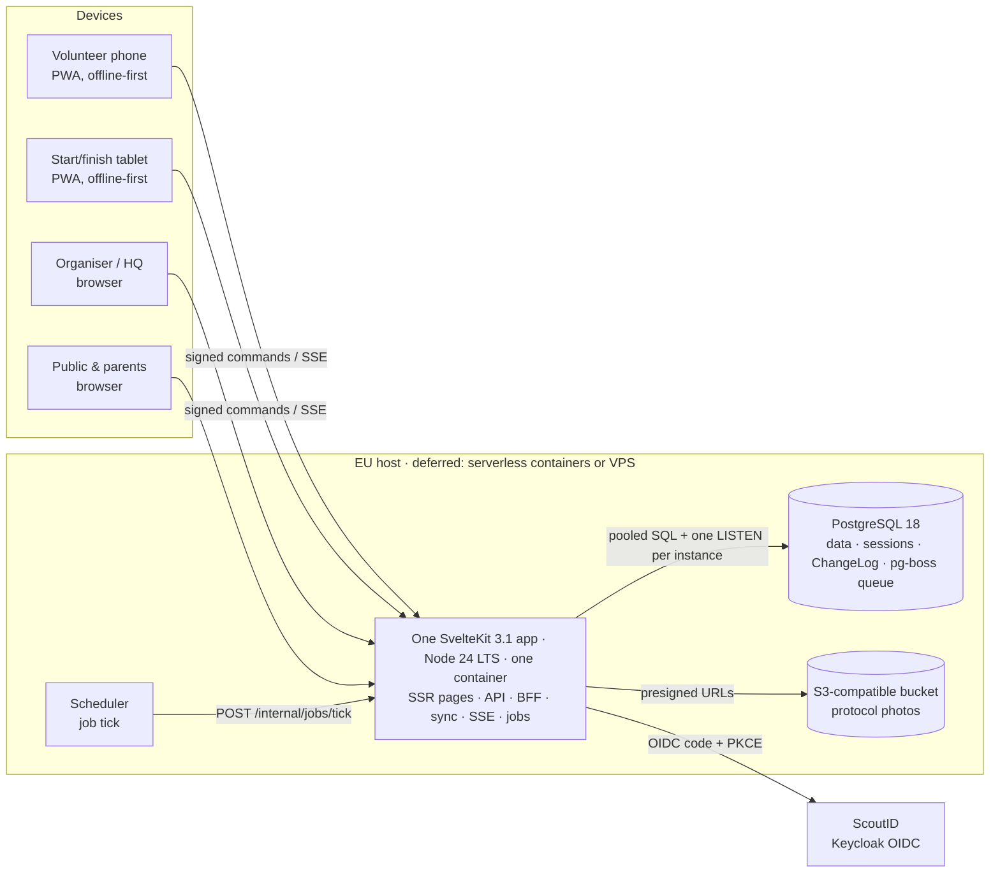

# scouttavling.se — Architecture overview

Status: proposal, 2026-10-15 (revised: TypeScript end-to-end, hosting deferred) · Sections: [02 Backend & domain](02-backend-and-domain.md) · [03 Client](03-client.md) · [04 Security & operations](04-security-and-operations.md)
UI design (all screens and user journeys): https://claude.ai/artifact/53qBCbWvJdNHSihkWFGqd6

This document summarises the proposal and is **binding where the sections disagree**. Section 4 lists every such case and the decision taken.

## 1. What we are building

scouttavling.se is a rebuild of gokapp. It covers the same job: patrols, stations, scores and results for scout patrol competitions. The rebuild is designed around the people using it in the forest:

- **Volunteers** join a station by scanning a QR code. They need no account and can work without coverage for hours.
- **Organisers** log in with ScoutID and are guided through setup. Competitions can be single-day or multi-day.
- **Start & finish desk and HQ** see live status, alarms and messages.
- **Paper fallback** is built in: reserve protocols and patrol scorecards, entered or photographed afterwards, with conflict detection against digital scores.
- **Participant import** reads Scoutnet exports, Excel or CSV, and sensitive data never leaves the browser.

## 2. System at a glance

**Style:** one TypeScript codebase. One SvelteKit app is split into route groups (public, field, admin, HQ, ceremony, print), and the same app's server routes act as a modular monolith (02 §1). The pure `packages/domain` (ranking, distribution, sync rules, command signing) and `packages/schema` (Valibot) are shared by browser and server. The container is stateless: sessions, the job queue and the realtime change feed all live in Postgres. It can therefore scale to zero between events and run several instances on event days. SSE fan-out uses Postgres `LISTEN/NOTIFY` from day one. One instance carries about 500 patrols and 100 devices per competition, with several competitions live on the same weekend.

## 3. Key decisions

| Area | Decision | Main alternative rejected | Section |
|---|---|---|---|
| Stack | **TypeScript end-to-end**: SvelteKit 3.1.0 serves UI *and* API on Node.js 24.22.0 LTS, as one OCI container. This is the language the maintainer knows, with one codebase and a lean, scale-to-zero-friendly runtime. | Spring Boot/Java (maintainer doesn't know Java; two codebases); Rust/Axum (second language, slower feature work); Python; BaaS | 02 §1 |
| Shared code | `packages/domain` (pure TS) + `packages/schema` (Valibot 1.5.0) used by client and server. OpenAPI only if external integrations need it. | OpenAPI codegen between two languages | 02 §1, 03 §14 |
| Database | PostgreSQL 18.6 via **Drizzle ORM 0.45.4** + postgres.js 3.4.9, migrations with **drizzle-kit 0.31.11**. Pooled + direct URLs, so serverless and normal Postgres both work. | Kysely (good, but types and migrations by hand); MySQL (gokapp today) | 02 §1 |
| Domain | Competition → Day → Station → **ScoreItem**. A "kontrollgrupp" such as Mål is one station with several items. Item modes: RANGE, DISTINCT (labelled values), COUNT, CHECKIN, AUTO_ON_SCAN. Style points can be turned off per competition and per item. | Separate stations per finish item, as gokapp does | 02 §2 |
| Scores | Current `Score` plus append-only `ScoreRevision`, explicit `ScoreConflict`, no last-write-wins | — | 02 §4 |
| Client | One SvelteKit 3.1 / Svelte 5 app, offline field areas built on Dexie (IndexedDB) and a hand-written Workbox service worker | React 19 / Next 16 | 03 §1–2 |
| Realtime | Server-Sent Events from SvelteKit endpoints, with a per-competition ChangeLog cursor that resumes exactly. Fan-out via Postgres `LISTEN/NOTIFY` plus a polling backstop. Streams recycle at about 55 min. | WebSocket; in-process-only pub/sub | 02 §3, 03 §4 |
| Background work | **pg-boss 12.38.0** (Postgres queue) drained by instances and by a scheduled `POST /internal/jobs/tick`. Server PDF is optional and in a separate container. | graphile-worker (relies on LISTEN/session connections); always-on worker | 02 §8 |
| Auth (organisers) | ScoutID through a BFF in the **SvelteKit server**: `openid-client` 6.8.8 as a confidential client with PKCE, an httpOnly `__Host-sid` cookie, sessions in Postgres, CSRF double-submit. Users are keyed on `scoutnet_member_no`. | SPA public client | 04 §2 |
| Auth (field) | QR invite → device grant (ES256 via `jose` 6.2.12) bound to a WebCrypto key → every offline command signed | Plain bearer cookie | 04 §3 |
| Import | Parsed in the browser (SheetJS in a worker) against an allowlist of fields. Personnummer, addresses and criminal-record status are never uploaded, and the server rejects unknown fields. | Server-side parsing | 03 §8, 04 §6 |
| Printing | Browser HTML/CSS print for every A4 artifact, including "Save as PDF". A server PDF renderer is optional later. | All-server PDF (headless Chromium in the app image) | 03 §7, 02 §8 |
| Hosting | **Deferred.** Requirements: EU residency, OCI container, ≥60-min SSE requests, scale to zero with min-instances = 1 on event weekends. Options: Cloud Run (europe-north1) + Neon, Scaleway Serverless Containers + Serverless SQL, or a VPS (e.g. Hetzner) with Docker Compose + Traefik. | Committing to one host now | 04 §7 |
| Migration | No personal data moves from gokapp, only templates (`tools/gokapp-migrate --templates-only`). Pilot runs in parallel with gokapp. | Big-bang switch | 04 §8, 02 §9 |

## 4. Cross-section contracts (binding)

The three sections were written in parallel and drifted on a few interfaces. Where a row predates the move to TypeScript, the decision has been updated. These are the decisions; each section should be read with this table in mind.

| # | Topic | Divergence | **Decision** |
|---|---|---|---|
| C1 | Sync endpoints | 02: `POST /competitions/{cid}/sync` · 03: `/api/v1/sync/commands` + `/snapshot` · 04: `/api/sync` | Push: `POST /api/v1/competitions/{cid}/sync/commands` (≤100 commands per batch, ordered by `deviceSeq`). Pull: `GET /api/v1/competitions/{cid}/sync/snapshot?since=<cursor>`. Each command gets one result: `accepted{version}` · `duplicate` · `conflict{server}` · `quarantined{reason}` · `rejected{reason}`. |
| C2 | IDs | 02/03: UUIDv7 · 04: ULID | **UUIDv7** everywhere (commands, entities, grants). |
| C3 | Field-device auth | 03: device-scoped cookie · 04: ES256 device grant + signed commands | **04's model.** The grant (ES256 JWS, `typ st-grant+jwt`) and a non-extractable P-256 key live in IndexedDB. Each command is a JWS (`typ st-cmd+jwt`) whose body is 02's envelope (`commandId, deviceId, deviceSeq, baseVersion, type, payload, clientNow`) plus a `prev` hash. Unsent scores survive grant expiry or revocation. |
| C4 | Revoked/late commands | 02 asks | **Quarantine for HQ review, never drop.** These are resolved in the same conflict UI that paper entry uses. |
| C5 | Where the BFF runs | 03 asks | **The SvelteKit server owns** `/auth/login`, `/auth/callback`, `/auth/logout` (openid-client), the Postgres-backed session and CSRF (`X-XSRF-TOKEN`). UI, `/api/*` and `/auth/*` are one app on one origin, so there is no proxy routing. SSR `load` functions call server modules directly. `GET /api/v1/me` returns `{memberNo, name, groups[{groupNo, name}], roles[{competitionId, role, stationIds?}]}`. Any logged-in ScoutID user may create a competition; `groups` lists the organisations they can pick as owner. |
| C6 | Patrol QR payload | 02: `ST1:<comp>:<nr>:<check>` · 03: `https://scouttavling.se/p/{patrolCode}` | Combine both: **`https://scouttavling.se/p/ST1.<comp>.<nr>.<check>`** (`check` = 4-character HMAC). The in-app scanner parses and verifies it offline. A normal phone camera opens a neutral landing page showing the patrol name and "open in the scoring app", **not** the follow page. The follow page stays behind its own secret link `/f/<128-bit>`, so a photo of a patrol pass doesn't expose it. |
| C7 | Schema migrations | Flyway (Java stack) replaced | **drizzle-kit 0.31.11**: generated SQL files reviewed in PRs, plus hand-written SQL where needed. They run as a one-shot job on the direct DB URL before each rollout, never on app start, and are expand/contract so the previous revision and N-1 clients keep working. |
| C8 | Undo | — | 10 s undo window in the UI, with the outbox flushed about 3 s after the last change. Once sent, undo becomes a compensating `VoidScore` command. |
| C9 | Error reporting | 03 asks | **Sentry protocol** via `@sentry/sveltekit` 11.8.0 on client (with offline buffering) and server. The backend is GlitchTip 6.1.8 (self-hosted on a VPS, or hosted) or Sentry SaaS EU, chosen with hosting (04 §7). |
| C10 | "I mål" status | 02 asks | The Mål station's **AUTO_ON_SCAN** item sets the patrol to *I mål*. The C1 desk can override it. |
| C11 | Birth data | 02/04 allowed an optional birth year | **None stored.** Stripped in the browser; the import field allowlist has no birth field. |
| C12 | Shared domain code | New with the TS stack | `packages/domain` is the **single implementation** of ranking + tiebreak, distribution, item/score validation, sync `decide()` rules, the command envelope + JWS signing/verification, the QR parser and import normalisation. It is pure TS with no I/O (enforced by dependency-cruiser). The server result is authoritative, and the client uses the same code for previews and offline checks. `packages/schema` (Valibot) is the API contract. |

## 5. Version baseline

Every version below was verified against the npm registry, nodejs.org, postgresql.org and official release pages on **2026-10-15**, following the brief to use the latest stable versions. Re-check at the start of each phase.

| Layer | Pinned versions |
|---|---|
| Runtime | Node.js 24.22.0 LTS (`node:24.22.0-trixie-slim`), npm workspaces, TypeScript 6.0.3 |
| Server | SvelteKit 3.1.0 + `@sveltejs/adapter-node` 6.0.0, openid-client 6.8.8, jose 6.2.12, pg-boss 12.38.0, rate-limiter-flexible 11.2.2, `@aws-sdk/client-s3` 3.1152.0, nodemailer 10.1.1, pino 10.4.0, uuid 14.0.3 |
| Data | PostgreSQL 18.6, Drizzle ORM 0.45.4, drizzle-kit 0.31.11, postgres.js 3.4.9, restic 0.19.1 (offsite dumps / VPS) |
| Shared | Valibot 1.5.0 (`@valibot/to-json-schema` 1.8.0 only if OpenAPI is needed) |
| Client | Svelte 5.57.2, Vite 8.3.4, Dexie 4.4.6, Workbox 7.4.1, TanStack Svelte Query 6.3.3, Bits UI 2.19.5, Paraglide JS 2.29.0 |
| Field features | barcode-detector 3.2.2 / zxing-wasm 3.1.5, SheetJS 0.20.3 (from cdn.sheetjs.com, **not** npm `xlsx`) |
| Testing | Vitest 5.0.5, fast-check 4.10.2 + `@fast-check/vitest` 0.5.0, `@testcontainers/postgresql` 12.2.1, Playwright 1.64.1, axe-core 4.14.0, MSW 3.0.3, dependency-cruiser 18.6.0 |
| Tools | mysql2 3.24.6 (gokapp-migrate) |
| CI | actions/checkout v7.0.1, actions/setup-node v7.1.0, docker/setup-buildx-action v4.4.1, docker/metadata-action v6.2.0, docker/build-push-action v7.4.0, docker/login-action v4.6.0, trivy-action v0.36.0, attest-build-provenance v4.2.2 |
| Ops (by option) | Traefik v3.7.15 (VPS only), Uptime Kuma 2.5.6, GlitchTip 6.1.8, Prometheus 3.15.0 / Grafana 13.2.4 (VPS, optional), Keycloak 26.8.1 (local dev only) + scoutid-keycloak-provider v0.14.0 |

**Known freshness risks and pairing constraints:**

- **SvelteKit 3 ↔ TypeScript 7:** Kit 3.1.0 peers on `typescript ^6.0.0`, so TS 7.0.2 (native compiler) cannot be used anywhere in the monorepo yet. Move all packages together when the peer range widens.
- **SvelteKit 3:** released 2026-10-01. The fallback is SvelteKit 2.70.3 (with adapter-node 5.5.7), using the same architecture.
- **`@vite-pwa/sveltekit`:** doesn't support SvelteKit 3 yet, hence the hand-written Workbox service worker.
- **Drizzle 1.0:** in RC (`1.0.0-rc.4`) while 0.45.x is "latest". Plan one upgrade during the build, and keep queries in per-module repo files.
- **Node 26:** "Current" (26.12.0), and becomes LTS at the end of October 2026. Switch the base image at the first 26.x LTS.
- **pg-boss** brings its own `pg` driver next to postgres.js. That is accepted, since only pg-boss uses it.

## 6. Open questions

**Answered by the organisers (2026-10-15):**
- **Exact ties share the place** (1, 2, 2, 4); no further tiebreak.
- **Birth year is not needed.** No birth data is stored; the import strips birth years in the browser, including inside free-text member lists.
- **Operator / GDPR processor:** normally the **scout district**; Scouterna or an association are also acceptable. The owning kår (or district) remains controller.
- **Who may create competitions:** **any logged-in ScoutID user.** No role-key check; the owning kår/district is picked from their memberships (04 §2.4).
- **ScoutID production:** will be live before scouttavling.se goes live, so nothing waits on it. Build against `dev.id.scouterna.se`; request the prod client when it opens (draft email in 04 §2.7).
- **Backend language (product owner, 2026-10-15):** TypeScript end-to-end, one codebase.

**For the team:**
1. **Hosting (deferred).** Choose between serverless containers (Cloud Run + Neon, or Scaleway Serverless Containers + Serverless SQL) and a VPS, after the phase-0 spike measures cold starts and SSE behaviour (04 §7). Does the district, as processor, require an **EU-owned** provider? That would rule out Cloud Run/Neon.
2. Whether to add Postgres row-level security on top of the app-level scoping to each competition (02 §2, 04 §4).
3. Confirm the prices that could not be verified: Scaleway Serverless SQL, Hetzner after its 2026 repricing, and 46elks. The docs give ranges.

## 7. Suggested build order

0. **Spike (2–3 weeks), on a serverless container *and* a VPS with the same image:**
   - ScoutID dev login through the SvelteKit server with `openid-client` (PKCE, Postgres session, CSRF).
   - SSE through the platform front end: 60-min limit, 55-min recycle and resume, and `LISTEN/NOTIFY` fan-out across two instances on a pooled/direct serverless Postgres.
   - A signed offline command round-trip (WebCrypto key → `jose` verification → `decide()`) on a cheap Android phone in flight mode.
   - Cold-start time with min-instances 0 vs 1, and the drizzle-kit migrate job.
   - Exit: hosting decision (04 §8, phase 0).
1. **MVP for the pilot:**
   - Organiser setup (single- and multi-day, stations with items).
   - Patrol import plus self-registration.
   - QR invites and volunteer scoring with offline sync.
   - Start & finish desk, including the combined finish (samlad målgång).
   - Reserve protocol and scorecard printing.
   - Results.
2. **Pilot competition:** run in parallel with gokapp, which stays the system of record. Compare rankings with the migration checker (02 §9).
3. **Day-of features:** HQ dashboard with alarms, messages with read receipts, paper entry/photo with conflict review, follow-my-patrol, prize ceremony.
4. **Default for new competitions, then decommission gokapp.** Keep a static results archive and wipe gokapp's database (04 §8).

## 8. Housekeeping

The repo root contains a real Scoutnet export (`Hajk-DM 2022 … .xls`) with personnummer and addresses. It has never been committed. `.gitignore` now excludes `*.xls`, `*.xlsx`, `*.csv`, `*.ods` and `.env*`. Still to do: add a secrets/personnummer scan to CI (04 §6.5).
