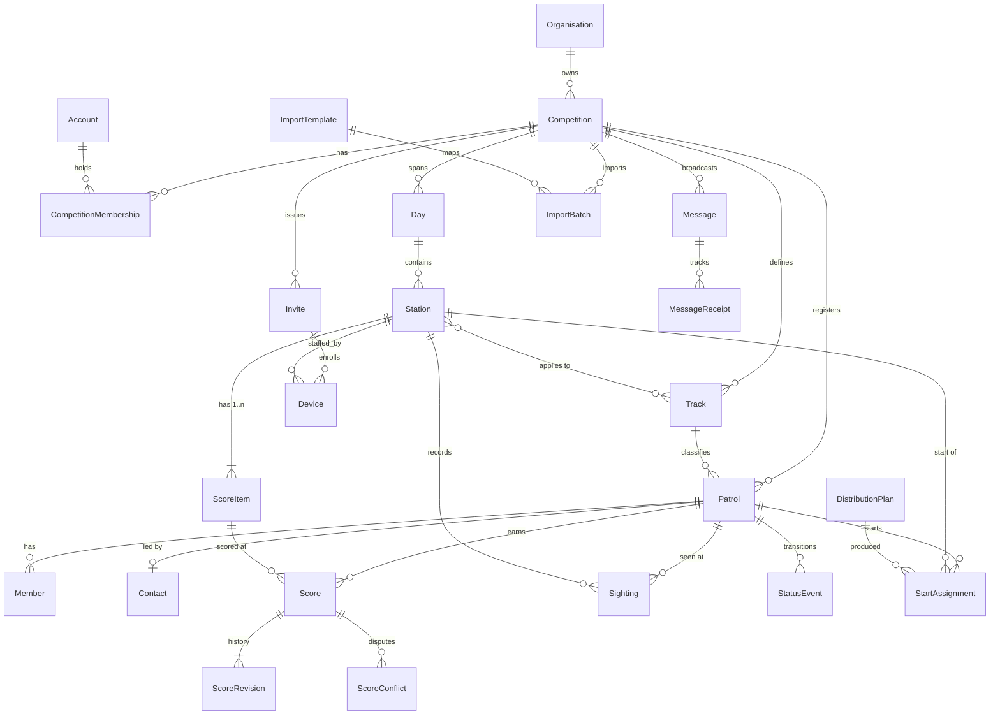

# 02 – Backend, domain model, API and sync

Status: proposal · Scope: server side of scouttavling.se · Companion sections: 03 (client), 04 (security & operations)

This section makes the backend decisions for scouttavling.se: the stack, the domain model, the API and realtime channel, the offline sync protocol, the core algorithms (ranking, start distribution, import), background work and how data moves over from gokapp. Each subsection gives a recommendation first and the reasoning after it. Interfaces the other sections depend on are marked **[→ 03 client]** or **[→ 04 security/ops]**.

Version numbers were checked against the npm registry, nodejs.org and postgresql.org on 2026-10-15.

---

## 1. Backend stack

### Decision

**TypeScript end-to-end, one codebase.** The SvelteKit app chosen in 03 also serves the API, BFF, sync and SSE from its server routes and `hooks.server.ts`. It ships as **one OCI container** on Node.js LTS, backed by **PostgreSQL 18**. The container makes no assumption about the host (04 §7): it runs on serverless containers that scale to zero, or on a VPS.

| Concern | Choice (version) | Notes |
|---|---|---|
| Runtime | **Node.js 24.22.1 LTS** ("Krypton") | Node 26.12.0 is "Current" and becomes LTS at the end of October 2026. Move at the first 26.x LTS release. |
| Language | **TypeScript 6.0.3** | SvelteKit 3.1.0's peer range is `typescript ^6.0.0`, so TypeScript 7.0.2 (native compiler) cannot be used yet, in the app or the packages. Move everything together when the peer range allows it. |
| Framework | **SvelteKit 3.1.0** + `@sveltejs/adapter-node` **6.0.0** | API under `src/routes/api/v1/**/+server.ts`. Session, CSRF, rate limits and security headers live in `hooks.server.ts`. Server-only code lives in `src/lib/server/` (SvelteKit refuses to bundle it into the client). |
| Monorepo | **npm workspaces** | `apps/web`, `packages/domain`, `packages/schema`, `packages/ui` (03 §14). The gokapp import is a CLI in `apps/web/scripts` (§9). |
| Shared domain | `packages/domain`: **pure TS, no I/O** | Ranking and tiebreak, distribution strategies, item/score rules, import normalisation, sync conflict rules, command envelope, JWS signing and verification. Used by the server (authoritative) and the client (previews, offline validation). |
| Validation | `packages/schema`: **Valibot 1.5.0** | Every API body, command payload, station pack and import row. `v.strictObject` rejects unknown keys. The schemas *are* the API contract, shared at compile time. OpenAPI is optional: generate it with `@valibot/to-json-schema` **1.8.0** only if an external integration needs it. |
| Database | **PostgreSQL 18.6** (supported to 2030-11) | Reasons below. |
| Query layer | **Drizzle ORM 0.45.4** with **postgres.js 3.4.9** | See "Query layer" below. |
| Migrations | **drizzle-kit 0.31.11** | `drizzle-kit generate` writes reviewed SQL files from the TS schema. Hand-written SQL (`generate --custom`) covers triggers and anything else the diff can't express. A one-shot migrate job applies them before rollout, never on app start (several instances). gokapp's `ddl-auto=update` is retired. |
| Jobs | **pg-boss 12.38.0** | Section 8. |
| Auth | **openid-client 6.8.8** (ScoutID BFF), **jose 6.2.12** (grants, command JWS) | Both by panva. openid-client is OpenID-certified. **[→ 04 §2–3]** |
| Other | uuid **14.0.3** (UUIDv7), rate-limiter-flexible **11.2.2** (Postgres store), `@aws-sdk/client-s3` **3.1152.0** (any S3-compatible EU bucket), nodemailer **10.1.1** (SMTP relay), pino **10.4.0** (redacting logger) | SMS through 46elks' REST API with `fetch`. No SDK is needed. |
| Tests | Vitest **5.0.5**, fast-check **4.10.2** + `@fast-check/vitest` **0.5.0**, `@testcontainers/postgresql` **12.2.1**, Playwright **1.64.1** | Section 10. |

**Why PostgreSQL over MySQL (gokapp's DB):**
- Partial unique indexes, for example "one *active* score per patrol+item", are needed by the sync model.
- `INSERT … ON CONFLICT … RETURNING` gives single-statement idempotent command handling.
- `jsonb` holds mapping templates, distinct-value labels and command payloads without extra tables.
- `LISTEN/NOTIFY` gives multi-instance SSE fan-out without a broker (§3).
- `SKIP LOCKED` gives a job queue without extra infrastructure (§8).
- Row-level security is available as defence in depth (decision deferred to 04).
- Serverless and managed Postgres is easy to find in the EU (04 §7).

The cost of switching is one migration script (section 9), which we need anyway because the model changes.

**Query layer: Drizzle over Kysely.**
- **For Drizzle:** one TS schema file is the source for both row types *and* SQL migrations, which is less code for a single maintainer. It covers everything the sync path needs: `onConflictDoNothing().returning()`, `.for('update')`, partial indexes (`` uniqueIndex().on(...).where(sql`state = 'ACTIVE'`) ``), and a raw `sql` template for anything else. It has drivers for postgres.js, node-postgres and Neon.
- **For Kysely 0.29.6:** a thinner, very SQL-shaped builder with a long-stable API. But types must be generated from a live database (kysely-codegen), and migrations are written by hand.
- **Risk we accept:** Drizzle is pre-1.0. 1.0 has been in RC since mid-2026 (`1.0.0-rc.4`), so plan one upgrade during the build and keep business queries in `src/lib/server/*/repo.ts` to contain it. Drizzle is also the layer the implementation started with.

**Connections (serverless-safe).** Two URLs, both plain Postgres, so any provider works:
- `DATABASE_URL`: pooled (PgBouncer transaction mode on Neon, the proxy on Scaleway Serverless SQL, or direct on a VPS). postgres.js runs with `prepare: false` and a small pool (`max: 5` per instance), because poolers in transaction mode break named prepared statements.
- `DATABASE_URL_DIRECT`: a session connection, used only for migrations and the one `LISTEN` connection per instance (§3). Transaction-mode poolers don't support `LISTEN`.

Session-level advisory locks are not used anywhere. Where mutual exclusion is needed, `pg_advisory_xact_lock` inside a transaction is used instead.

**Shape of the monolith.** One folder per module under `src/lib/server/`, each exporting a public `index.ts`, with the rest private:
`competition` (competitions, days, tracks, stations, items, settings), `registration` (patrols, members, contacts, registration windows), `scoring` (scores, revisions, conflicts, sync), `progress` (status events, sightings, alarms), `distribution`, `results` (ranking, reveal, exports), `messaging`, `importing`, `identity` (accounts, sessions, memberships, invites, devices), `realtime` (change feed and SSE), `jobs`.

dependency-cruiser **18.6.0** fails the build on imports past another module's `index.ts`, and on any `packages/domain` import of I/O (`node:*`, `$lib/server`, Drizzle). The algorithm cores live in `packages/domain`, as gokapp's `Distribute` is free of Spring, so they are fast to unit- and property-test and run unchanged in the browser.

### Alternatives considered

**A. Spring Boot 4.1 / Java 25 (previous proposal).**
- For: gokapp's maintainers write Spring, and its rules port almost line by line.
- Against: the product owner who will maintain this does not know Java. It means two codebases and two toolchains, plus OpenAPI codegen to share types. JVM start-up and memory sit poorly with scale-to-zero.
- Verdict: **rejected.** gokapp's rules are small and are ported to TS under parity tests (§9–10).

**B. Rust (Axum).**
- For: the leanest and fastest option, with tiny images, millisecond cold starts and strong typing. The maintainer knows Rust.
- Against: it is a second language next to the TS client, so the shared domain package goes away and rules are duplicated or compiled to WASM. Feature work is slower. The ecosystem is thinner where we need it most: certified OIDC RP libraries, xlsx, and mail.
- Verdict: **not needed.** Load is tiny (04 §7.1). It stays possible later for a hot spot behind the same Postgres.

**C. Python (FastAPI).** Productive and known to the maintainer. But it is still a second language and gives no shared offline domain code, so it has the same objection as B without B's runtime benefits.

**D. Backend-as-a-service (Supabase, PocketBase, Firebase).**
- For: fast CRUD, with auth and realtime built in.
- Against: the hard parts are server-side rules: conflict detection that never overwrites, signed device commands, quarantine, the "never store sensitive columns" guarantee, and ScoutID claim mapping on `scoutnet_member_no`. These turn into database functions and policies that are hard to test, and they tie us to the vendor's auth and realtime semantics.
- Verdict: rejected for the core. Buying managed or serverless Postgres is fine.

---

## 2. Domain model

### Naming decisions
- **Track** (UI: *klass*) is the competition category. The name is kept from gokapp.
- **Station** is a physical post with a QR code, a queue, volunteers, a day and a code. A **ScoreItem** (UI: *delmoment*) is one thing that gets scored there. A simple station has exactly one item. What the requirements call a *StationGroup* (for example "Mål" with målregistrering, nödbrev, händighet and orientering) is **a Station with several ScoreItems**. One scan opens all of its items on one screen. The patrol stays in the station's queue until every required item has an active score.
- **Score** is the current value for one *(patrol, item)*. **ScoreRevision** is the append-only history behind it.

### Entities (key fields)

**Tenancy & identity**
- `Organisation`: a kår. `id, scoutnet_group_id?, name`. Owns competitions.
- `Account`: a ScoutID user. `id, scoutnet_member_no (unique, stable key), display_name, email, phone, last_login_at`. We never key on `sub`. **[→ 04]** decides which claims are cached and for how long.
- `CompetitionMembership`: `competition_id, account_id | invited_member_no, role (OWNER | ADMIN | HQ | START_FINISH | STATION_LEAD | VIEWER), station_id?, invited_by, accepted_at`. Inviting co-organisers by member number creates a row with `invited_member_no`, which is bound to the account on first ScoutID login.
- `Invite`: `id, competition_id, kind (STATION | STAFF), station_id?, role?, secret_hash, generation, valid_from, valid_until, max_devices, require_approval, revoked_at` (04 §3.2). It is the payload of the QR join code.
- `Device`: a volunteer phone. `id (client-generated UUIDv7), competition_id, station_id?, invite_id, display_name ("Anna"), account_id?, public_jwk, jkt (key thumbprint), grant_jti, last_seen_at, last_sync_seq, last_cmd_hash, clock_skew_ms, revoked_at`. Volunteers have no account. The device row is their identity in audit.

**Competition structure**
- `Competition`: `id, slug, owner_org_id, name, status (DRAFT | OPEN | LIVE | FINISHED | ARCHIVED), timezone (Europe/Stockholm), style_points_enabled, public_results (OFF | LIVE | AFTER_FINISH), reveal_mode_enabled, registration_opens_at, registration_closes_at, max_patrols, payments_enabled, registration_info, confirm_message, copied_from_id?`. This absorbs gokapp's `Config` and `RegistrationConfig`.
- `Day`: `id, competition_id, index (1..n), date, prefix ("F","L","S"), label ("Fredag")`. A single-day competition has one Day and prefix "".
- `Track`: `id, competition_id, name, short_code, sort_order`. No age rules: organisers decided (2026-10-15) that birth year is not needed.
- `Station`: `id, competition_id, day_id, kind (START | REGULAR | FINISH), order_in_day, code (derived: prefix + order, with S/M for start and finish, e.g. "L3", "LM"), paper_code? (overrides the code on printouts), name, applies_to_all_tracks, startable (may patrols start here), required_for_completion, contact_name, contact_phone, location_hint`. Linked to `station_track(station_id, track_id)`.
- `ScoreItem`: `id, station_id, order, name, mode, min, max, step (default 1), distinct_values jsonb [{value:20,label:"Oöppnat"},{value:0,label:"Öppnat"}], count_multiplier?, style_enabled, style_min, style_max, counts_for_tiebreak (default true; always false for CHECKIN/AUTO)`.
  - `mode` is one of `RANGE`, `DISTINCT`, `COUNT` (input a count, points = count × multiplier capped at max; e.g. "orientering = antal × 2"), `CHECKIN` (gokapp WAYPOINT: visited yes/no, 0 points), or `AUTO_ON_SCAN` (målregistrering: created as soon as the station scans the patrol).
  - Style points are effective only if the competition has `style_points_enabled` **and** the item has `style_enabled`.

**Participants**
- `Patrol`: `id, competition_id, track_id, number (short human number, printed and in QR), name, org_text (as entered), org_id? (normalized kår), status (ANMALD | PA_BANAN | I_MAL | ATERBUD), status_version, paid, note, follow_token (unguessable, for the public "följ patrullen" page), registered_by_account_id?, external_key (import idempotency, see section 7), legacy_id?, created_at`.
- `Member`: `id, patrol_id, first_name, last_name, org_text, scoutnet_member_no?`. **No birth data at all** (organiser decision 2026-10-15). Birth year, birth date, personnummer and gender are never stored.
- `Contact`: `id, patrol_id, name, email, phone_e164, scoutnet_member_no?`. The patrol leader. "Mina patruller" is a lookup on `scoutnet_member_no`.

**Scoring & progress**
- `Score`: `id (client-generated UUIDv7), competition_id, patrol_id, item_id, points, style_points, raw jsonb (count / chosen distinct value / visited), state (ACTIVE | VOIDED), version (int, server-assigned), origin (DEVICE | PAPER | ADMIN | MIGRATED), created_by_device_id?, created_by_account_id?, recorded_at_client, received_at, updated_at`.
  - Partial unique index: `UNIQUE (patrol_id, item_id) WHERE state='ACTIVE'`.
- `ScoreRevision`: append-only. `id, score_id, version, op (CREATE | AMEND | VOID | RESTORE | RESOLVE), points, style_points, raw, reason?, command_id, actor_device_id?, actor_account_id?, actor_label, recorded_at_client, received_at, base_version?`. It backs the history line "ändrad av X, var 7+3, orsak …".
- `ScoreConflict`: `id, patrol_id, item_id, current_score_id, current_version, incoming_command_id, incoming_payload, origin, status (OPEN | RESOLVED_KEEP | RESOLVED_TAKE_INCOMING | RESOLVED_MANUAL), resolved_by, resolved_at`.
- `Sighting`: `id, patrol_id, station_id, device_id, command_id, seen_at_client, received_at`. Created by every scan. It drives queues ("scanned but items missing") and the "not seen for N minutes" alarm.
- `StatusEvent`: `id, patrol_id, from_status, to_status, station_id?, device_id | account_id, command_id, at_client, received_at`. `Patrol.status` is a denormalized projection of these events. gokapp's free-text `startTime`/`endTime` become events.
- `ProcessedCommand`: `command_id (PK), device_id, device_seq, type, result jsonb, processed_at`. This is the idempotency ledger.

**Distribution**
- `DistributionPlan`: `id, competition_id, day_id, strategy (ROUND_ROBIN_ALL | ROUND_ROBIN_PER_TRACK | BALANCED), params jsonb, status (DRAFT | COMMITTED | DISCARDED), metrics jsonb, created_by, committed_at`.
- `StartAssignment`: `patrol_id, day_id, station_id, start_slot?, locked, plan_id`. Unique on `(patrol_id, day_id)`.

**Messaging**
- `Message`: `id, competition_id, title, body, priority (NORMAL | REQUIRES_ACK), kind (INFO | BACKUP_MODE | BACKUP_MODE_OFF), audience jsonb (all / roles / station ids), created_by, created_at, retracted_at`.
- `MessageReceipt`: `message_id, recipient (device_id | account_id), delivered_at, read_at, acked_at`.

**Import**
- `ImportTemplate`: `id, owner_org_id? (null = global, e.g. "Scoutnet evenemangsexport"), name, source_kind, header_match_rules jsonb, column_map jsonb (source header pattern → target field), value_maps jsonb (class text → track short_code, Anmäld values to skip), version`.
- `ImportBatch`: `id, competition_id, template_id, template_version, file_fingerprint (hash of the mapped rows, not the file), created_by, status (DRY_RUN | COMMITTED | FAILED), counts jsonb, row_outcomes jsonb (sourceRowKey → created/updated/unchanged/skipped/error + message; no source data)`.
- `OrgAlias`: `normalized_text → org_id` (merges kår spellings such as "Sjöscoutkåren X" vs "X sjöscoutkår").

**Results & cross-cutting**
- `ResultReveal`: `competition_id, track_id, frozen_at, frozen_change_seq, revealed_down_to_place`. Prize-ceremony mode.
- `PaperUpload`: `id, competition_id, station_id?, object_key, uploaded_by, created_at`. Photo of a paper protocol, linked to the `ScoreRevision`s entered from it. Storage and retention: **[→ 04]**.
- `ChangeLog`: `competition_id, seq, entity, entity_id, op, payload jsonb, at`, PK `(competition_id, seq)`. `seq` is per competition, taken from a `competition_seq` counter row. Written in the same transaction as every domain change. It drives SSE and incremental pulls (section 3).
- `AuditLog`: admin actions outside scoring (settings, deletes, role changes, exports of personal data).

### ER diagram (core)



**Tenancy rule.** Every table carries `competition_id` (directly or through its aggregate root). Every repository function takes a `CompetitionScope` as its first argument. It is resolved from the URL and checked against membership or device, and it is a branded type that only the auth guard can construct, so an unscoped query does not type-check (§10). Whether to add Postgres RLS on top is **[→ 04]**.

**Copy from last year.** `POST /competitions/{id}/copy` deep-copies Days (dates shifted by a given offset), Tracks, Stations, ScoreItems, settings and Memberships (optional). It never copies Patrols, Members, Contacts, Scores or Messages.

---

## 3. API design

### Decision: REST/JSON + SSE, contract = shared Valibot schemas

- **REST** under `/api/v1`, implemented as SvelteKit `+server.ts` handlers. Every handler parses its input with the shared schema from `packages/schema` before touching the domain. Resources map cleanly to the domain, and HTTP caching works for public results. Volunteer devices need only a handful of endpoints.
- **GraphQL and tRPC were rejected.** GraphQL adds schema and tooling weight, makes caching harder, and does nothing for the hard part (offline writes). tRPC would couple the URL design to one client and hide plain HTTP, which the service worker and cache rules need to see.
- **The write path for field devices is a command endpoint, not CRUD.** Offline clients replay intentions ("record 7+3 for patrol 42 at item X, base version 2"), not entity states.

### Main endpoints

Competition admin (ScoutID session cookie + CSRF header, role-checked):
```
GET/POST        /competitions                       (mine / create)
GET/PATCH       /competitions/{cid}
POST            /competitions/{cid}/copy
CRUD            /competitions/{cid}/days | tracks | stations | stations/{sid}/items
CRUD            /competitions/{cid}/patrols         (+ ?track=&status=&q=)
POST            /competitions/{cid}/patrols/{pid}/status      {to, baseStatusVersion}
CRUD            /competitions/{cid}/memberships     (invite by member number)
POST            /competitions/{cid}/invites          → {qrPayload, url}   (station / staff)
DELETE          /competitions/{cid}/devices/{did}    (revoke)
POST            /competitions/{cid}/distribution-plans          {dayId, strategy, params} → draft + metrics
PATCH           /competitions/{cid}/distribution-plans/{id}     {moves:[{patrolId, stationId, lock}]}
POST            /competitions/{cid}/distribution-plans/{id}/commit
GET             /competitions/{cid}/conflicts?status=OPEN       (incl. quarantined commands)
POST            /competitions/{cid}/conflicts/{id}/resolve      {resolution, points?, style?, reason}
GET             /competitions/{cid}/scores/{scoreId}/revisions
POST/GET        /competitions/{cid}/messages, /messages/{id}/receipts
GET             /competitions/{cid}/dashboard                   (snapshot; deltas via SSE)
POST            /competitions/{cid}/imports/dry-run   {templateId, rows:[…mapped…]} → diff
POST            /competitions/{cid}/imports/{batchId}/commit
CRUD            /organisations/{oid}/import-templates
GET             /competitions/{cid}/results?track=   (full detail, admin)
GET             /competitions/{cid}/exports/results.{xlsx|csv}  (.pdf only if the optional renderer is enabled, §8)
POST            /competitions/{cid}/reveal/{trackId}  {action: freeze|next|show-all}
```
Print artifacts are SSR routes under `/print/…` printed by the browser (03 §7), not API endpoints.

Field devices (device grant + signed commands, 01 C1/C3, 04 §3):
```
POST  /join                                   {secret, displayName, publicJwk, nonceSig} → {grant, serverKeys}
GET   /competitions/{cid}/station-pack        → station, items, expected patrols, current scores (with versions), messages, serverTime, cursor
POST  /competitions/{cid}/sync/commands       {commands:[jws…]} (≤100, deviceSeq order) → per-command results
GET   /competitions/{cid}/sync/snapshot?since=<cursor>  → changes since cursor
GET   /competitions/{cid}/events              (SSE)
```

Public (no auth, cache-friendly):
```
GET /public/{slug}                           (info, registration window)
POST /public/{slug}/registrations            (ScoutID optional; rate-limited [→ 04])
GET /public/{slug}/results?track=            (only if public_results allows; frozen snapshot in reveal mode)
GET /public/follow/{followToken}             (one patrol's progress; no member names [→ 04])
GET /me, /me/patrols                         (ScoutID: profile, roles; contacts/members matching my member no)
```

**QR payload [→ 03].** Binding format: 01 C6 (`https://scouttavling.se/p/ST1.<comp>.<nr>.<check>`, `check` = 4-character HMAC truncated with a per-competition key). The parser and checker live in `packages/domain/qr`, so the scanner verifies it **offline** with the same code the server uses. It holds no personal data, and the checksum rejects mistyped or foreign codes. Invite QR codes are URLs (`https://scouttavling.se/j/<secret>`) so that a phone camera opens the app.

### Realtime channel

**Decision: Server-Sent Events from SvelteKit endpoints, backed by the `ChangeLog`, fanned out with Postgres `LISTEN/NOTIFY` from day one.**
- One stream per client: `/competitions/{cid}/events?topics=dashboard,messages,station:{sid}`. Public results use `/public/{slug}/results/stream`.
- The handler returns a `ReadableStream` with `text/event-stream` and sends a comment heartbeat every 20 s. It **ends the stream itself after about 55 min**, because serverless platforms cap requests at 60 min (04 §7.2). `EventSource` reconnects with `Last-Event-ID` and resumes exactly, so there are no gaps.
- **Event ids are a per-competition sequence.** `ChangeLog.seq` is allocated by `UPDATE competition_seq SET seq = seq + 1 … RETURNING seq` inside the domain transaction. The row lock makes commit order equal seq order per competition. A global `bigserial` can commit out of order (101 visible before 100), which would make cursor resume skip events.
- **Fan-out across instances.** The domain transaction also runs `pg_notify('changelog', '<cid>:<seq>')`, which is delivered on commit. Each instance holds **one** listener (postgres.js `sql.listen` on `DATABASE_URL_DIRECT`, auto-reconnecting). On a notification, the instance reads `ChangeLog WHERE competition_id = $1 AND seq > $lastSeq` once and pushes it to its local subscribers, filtered by topic and permission. Database load scales with instances, not clients.
- **NOTIFY is only a wake-up hint, never the data path.** While an instance has subscribers, it also polls the ChangeLog every 3 s. That covers listener reconnects and providers where delivery is best-effort (Scaleway Serverless SQL documents this). Correctness rests on the cursor alone.
- **Why not WebSocket.** All traffic is server→client (writes go through `/sync/commands`). SSE works over HTTP/2 through every serverless front end and reverse proxy, reconnects automatically, and on Node each open stream is just a socket, not a thread.
- **Dashboard events:** `score.changed`, `sighting`, `status.changed`, `conflict.opened/resolved`, `device.online/offline` (from sync heartbeats), `alarm.patrol-unseen`, `message.receipt`. The server sends **small deltas**. The dashboard fetches a fresh snapshot on start and then applies the deltas.
- **Public results** are not pushed per score. A coalescer recomputes the standings at most every 10 s per track and emits `results.updated` with the full (small) table. The same table is served by `GET /public/{slug}/results` with `Cache-Control: max-age=5`. Where a platform caps concurrent requests per instance low (Scaleway: 80), public viewers use cached polling instead of SSE, and SSE is kept for staff and devices.
- **Alarms:** while a competition is LIVE, a tick every 30 s takes `pg_try_advisory_xact_lock(cid)` so that only one instance works per competition. It computes `now − max(last sighting, last score, start time)` for patrols `PA_BANAN` and raises or clears `alarm.patrol-unseen` against the competition's N minutes. Offline stations are flagged from `Device.last_seen_at`. On event weekends one instance is pinned (04 §7.2), so the tick always has a host.
- **Scale assumption:** at most about 500 patrols and 100 devices per competition, a few competitions live at once. One instance carries this. Several instances work without changes because of the fan-out above.

---

## 4. Offline sync protocol

This is the core of the system. The design goals are: **no lost input, no silent overwrite, deterministic outcome, and a protocol simple enough for volunteers to debug.** The rules below are implemented once, in `packages/domain/sync` (pure functions over current state + command → outcome). The server runs them inside a transaction. The client uses the same code to predict outcomes and to explain them in the UI.

### Client side (contract for 03)
1. On joining, the device downloads the **station pack** and stores it in IndexedDB. The pack holds the station, its items and validation rules, the expected patrols (all eligible patrols of the station's tracks; patrol number, name, track, QR check), the current active scores at this station with their `version`, unread messages, `serverTime` and a `cursor` (ChangeLog seq).
2. Every user action becomes a **command** in a persistent **outbox**. The envelope is defined once in `packages/schema` and is signed as a JWS by the device key (01 C3, 04 §3.2):
   ```json
   { "commandId": "0192…(UUIDv7)", "deviceId": "…", "deviceSeq": 118,
     "type": "RecordScore", "clientNow": "2026-05-16T10:42:13.120+02:00",
     "baseVersion": null, "prev": "<hash of previous command JWS>",
     "actorLabel": "Anna",
     "payload": { "scoreId": "0192…", "patrolNumber": 42, "itemId": 311,
                  "points": 7, "style": 3, "raw": {"value":7} } }
   ```
   - Command types: `RecordSighting`, `RecordScore`, `AmendScore`, `VoidScore`, `SetPatrolStatus`, `MarkMessageRead`, `AckMessage`.
   - `deviceSeq` increases strictly per device and is persisted before the command is shown as saved.
   - `scoreId` is client-generated, so the device can amend its own not-yet-synced score by id.
3. **Undo within seconds.** An undo (default window 10 s) shows only while the outbox entry is unsent. Undoing removes the command locally, and nothing reaches the server. The flusher waits about 3 s after the last edit before sending a batch, so most undos are free. If the command was already sent, undo sends a `VoidScore {scoreId, baseVersion}`. The server accepts it without a reason when the same device sends it within 2 minutes of the create. Otherwise it needs a reason like any edit. Both paths stay visible in the revision history.
4. Each flush is one `POST /sync/commands` with up to 100 commands in `deviceSeq` order (01 C1). The server answers per command. The client then pulls `/sync/snapshot?since=<cursor>`, which updates local versions and shows other devices' entries on the same station.

### Server reconciliation
The handler first verifies the grant and each command signature with `jose` (04 §3.3). Then it processes each command, in `deviceSeq` order, in its own Drizzle transaction (`db.transaction(async tx => …)`):
1. **Idempotency.** `tx.insert(processedCommand).values(…).onConflictDoNothing({ target: processedCommand.commandId }).returning()`. If nothing is returned, the stored `result` is returned as `duplicate`. Retries after a lost response are therefore harmless.
2. **Authorization.** The device must be active and bound to the station that owns the item (or hold an HQ/admin role). A command from a **revoked device** is not discarded. It is stored as a `QUARANTINED` conflict for HQ, because a lost phone's last scores may be the only record (01 C4).
3. **Validation** reuses gokapp's rules (`isValidScorePoint`, `isValidStylePoint`), ported to `packages/domain/items` and generalised per mode. The item must apply to the patrol's track. A failure returns `rejected {reason}`, and the client shows it in the outbox's "needs attention" list.
4. **Apply with conflict rules.** The `(patrol, item)` row is locked with `.for('update')`, and then the pure `decide(current, command)` from `packages/domain/sync` is applied:

| Incoming | Server state | Outcome |
|---|---|---|
| `RecordScore`, base null | no active score | **accepted**: create Score v1 + revision CREATE |
| `RecordScore`, base null | active score with *identical* points/style/raw | **accepted (equivalent)**: no new version; a revision note "confirmed by device B / paper" is added. Two volunteers scoring the same patrol identically is not a conflict. |
| `RecordScore`, base null | active score with different values | **conflict**: existing kept, `ScoreConflict` opened, HQ and the station lead notified via SSE |
| `AmendScore`/`VoidScore`, base = current version | — | **accepted**: version+1, revision with reason |
| `AmendScore`/`VoidScore`, base ≠ current | — | **conflict** (someone else changed it meanwhile) |
| `RecordScore` from the same device with the same `scoreId` | — | treated as amend of own score (idempotent offline edits) |

   **Never last-write-wins.** The only automatic merge is "identical values". Resolving a conflict is an explicit `RESOLVE` revision with actor and reason.
5. **Side effects** in the same transaction: a `RecordSighting` is implied by any score; an `AUTO_ON_SCAN` item is created on the first sighting at its station; a `ChangeLog` row is written and `pg_notify` is called (§3); the dashboard queue is updated.
6. **Status commands** (`SetPatrolStatus`) use `status_version` the same way. The allowed transitions are ANMALD→PA_BANAN→I_MAL, any→ATERBUD and ATERBUD→ANMALD, plus admin-only reverse moves. A start-desk scan of a patrol that is already PA_BANAN is accepted as equivalent. A scan at the finish station sets I_MAL **only** when the competition is configured that way (finish desk vs. Mål station, 01 C10).

A batch of 100 commands is about 100 short transactions, well under a second. Transactions stay short, as serverless databases expect.

### Clocks and ordering
- **Ordering never depends on client clocks.** Per-score order is the server `version`. Per-device order is `deviceSeq`. Across devices there is no ordering requirement, because conflicts are detected by version, not by time.
- On each sync the server computes `skew = serverNow − clientNow` and stores it on the Device. Client timestamps are stored raw *and* skew-corrected. The corrected time is used for "last seen", start and finish times and the unseen alarm. If skew exceeds 2 minutes, the device is flagged on the dashboard and the client is told to show "check the phone's clock". Hybrid logical clocks would be overkill here.
- Start and finish times (which matter for any time-based rules) come from `StatusEvent.at_client` (corrected), not from the receive time, because the start desk may itself be offline.

### Paper entry uses the same mechanism
Bulk entry of reserve protocols or patrol scorecards in the admin UI creates the **same `RecordScore` commands** with `origin=PAPER`, `deviceId` = the admin browser's device id, `baseVersion=null` and an optional `paperUploadId`. The conflict table above then gives exactly what the organiser asked for:
- Paper equal to digital → confirmed (and audit shows both).
- Paper where digital is missing → applied.
- Paper different from digital → conflict for side-by-side review with the photo.

Photo upload (not built yet) is the case that may justify object storage: photos are large and many. Until then every upload is stored in Postgres through `assetStore.ts`, and a bucket with presigned PUTs is added only if uploads grow a lot (05 §6). Automatic recognition (OCR) is out of scope for v1.

### Backup mode (Reservläge)
A `BACKUP_MODE` message tells devices to switch to paper. Nothing changes server side. The point is that every later paper entry flows through the same pipeline, so going back to digital needs no special merge.

---

## 5. Ranking and tiebreak

The ranking is a **pure function** in `packages/domain/ranking`, `rank(rules, items, patrols, activeScores): Placement[]`, run per track. The same function drives the server's results, the client's offline preview on the HQ tablet and the ceremony snapshot.

Per patrol, over its *active* scores on items that apply to its track:
1. `total = Σ(points + effectiveStyle)` (style counts only where it is enabled for both the competition and the item).
2. `pointsOnly = Σ points` (score points without style).
3. `rankVector[r]` = number of items with `counts_for_tiebreak` and `points > 0` where `rankOfValue(item, points) == r`. Here `rankOfValue` is the item's position counted from the top of its **achievable value ladder**:
   - RANGE: `max, max−step, …, min`
   - DISTINCT: configured values in descending order
   - COUNT: `k × multiplier`, capped at max

   The tiebreak "most top scores, then most next-best, …" therefore treats a 0/5/10/15/20 station fairly alongside a 0–20 station. This generalises gokapp's `Station.rankOfScore`. Waypoints (CHECKIN) and AUTO items are excluded, and points = 0 is excluded, both as in gokapp.

The comparator orders by total descending, then pointsOnly descending, then `rankVector` lexicographically descending. gokapp loops r = 0..50. We compare the full vector length instead.

**Ties that remain** get the **same place** (1, 2, 2, 4), and display order within a tie is by patrol number. This differs slightly from gokapp, which leaves equal patrols in arbitrary order. **Confirmed by the organisers (2026-10-15): exact ties share the place.**

Other rules:
- ATERBUD patrols are listed after ranked patrols as "Återbud" and get no place.
- Patrols not yet I_MAL are ranked in live views with an "på banan" marker.
- Multi-day competitions rank on the sum over all days. Per-day standings come from the same function with an item filter.

Performance: 500 patrols × 40 items is about 20k scores and well under 10 ms in memory. Results are computed on demand and memoised per `(competition, track, ChangeLog.seq)`. There is no stored results table except the frozen `ResultReveal` snapshot. Exports all read the same `Placement` list: XLSX via SheetJS CE 0.20.3 (the library the import already uses, 03 §8, which runs in Node and the browser) and CSV with formula-injection escaping (04 §5). PDF comes from browser print, plus the optional renderer (§8).

---

## 6. Start-station distribution

There is one interface, `DistributionStrategy.plan(input: DistributionInput): Plan`, in `packages/domain/distribution`. The input is the patrols (with track), the eligible start stations per track (`startable`, applies to the track, same day, not START/FINISH kind), the locked assignments and an optional per-station capacity weight. Randomness comes from a seeded PRNG passed in, never `Math.random`, so previews are reproducible on client and server.

1. `ROUND_ROBIN_ALL`: gokapp behaviour (`Distribute`), ported as-is.
2. `ROUND_ROBIN_PER_TRACK`: gokapp behaviour. Each track restarts at station 0.
3. `BALANCED` (new, the default) works in three steps:
   - **Feasibility:** a track whose eligible set is empty is an error shown in the preview. A class is never started at a station it doesn't do. This is a hard constraint enforced by the candidate set.
   - **Greedy seeding:** place locked patrols first. Then take tracks in order of fewest eligible stations first (most constrained). Within a track, place patrols in a stable shuffled order (seeded). Each patrol goes to the eligible station minimising `(totalLoad[s] / capacity[s], trackLoad[s][t], sameKårLoad[s][kår], routeOrder(s))`. The aims are: overall group sizes even, each class spread across its stations, patrols from one kår not bunched together, and a deterministic tie-break.
   - **Local improvement:** repeat pairwise moves and swaps of unlocked patrols while they reduce `Σ(totalLoad − mean)² + λ·Σ(trackLoad − trackMean)²`, with a cap of 1,000 iterations. This is easily fast enough for hundreds of patrols, even in the browser.
   - **Metrics for the preview:** min/max/mean group size per station, per-track spread, and the number of locked patrols.

Plans are DRAFT until committed. Manual moves in the preview create locked entries. Re-running the strategy keeps them. Committing writes `StartAssignment`s in one transaction, emits a ChangeLog event, and makes station packs out of date (devices pick up the change on their next sync).

The same module computes the **expected visit order** per station: a patrol starting at station *k* visits the track's stations in route order, cyclically. This feeds the pre-filled reserve protocols and the "expected next" list on station devices.

---

## 7. Import pipeline

**Decision: parse in the browser and upload only mapped fields.** The server never receives the original file, so personnummer, address, belastningsregister, birth date, gender and relatives' email never reach our infrastructure. This is the strongest form of "never store", and it is the main interface with **[→ 03]** and **[→ 04]**.

1. **Format sniffing (client).** Formats are detected from the first bytes, not the file extension:
   - `<` / `<html` / `<table`: Scoutnet "xls", which is really an HTML table → `DOMParser`.
   - `PK`: xlsx.
   - `D0 CF 11 E0`: legacy binary xls.
   - otherwise: CSV/TSV (delimiter detection, UTF-8 vs Windows-1252 sniffing).
   Spreadsheet parsing library choice and pinning belongs to 03 (SheetJS CE 0.20.3 from its own CDN; the npm registry copy is older).
2. **Header detection and template match.** The client picks the first row that matches the template's `header_match_rules`. The Scoutnet template matches `Medlemsnummer`, `Namn`, `Kår`, `Anmäld`, and the form-question columns by suffix: `… – Patrullnamn / kontrollnummer`, `… – Vilken klass tävlar ni i?`, `… – Förnamn, Efternamn, kår och födelseår på alla i patrullen`.
3. **Allowlist mapping.** Only target fields defined by the import schema in `packages/schema` can be mapped: `contact.memberNo, contact.name, contact.email, contact.phone, patrol.name, patrol.trackText, patrol.orgText, members.freeText, registered (Anmäld)`.
   - The client also runs a **denylist** of header patterns (`/personnummer|adress|postnr|födelse|kön|belastning|anhörig/i`). Those columns cannot be mapped and are dropped before any upload.
   - The server repeats the check with the same `v.strictObject` schema. A payload containing unknown keys or a personnummer-shaped value is rejected, so a tampered client cannot smuggle data in.
4. **Upload** `POST /imports/dry-run` with normalised-ish rows plus a `sourceRowKey` (row index plus a hash of the mapped values).
5. **Normalisation** in `packages/domain/import`. The worker runs it for the preview, and the server runs the same code again authoritatively:
   - phone → E.164 (`070…` → `+4670…`)
   - email lower-case
   - kår text → `OrgAlias` lookup with a fuzzy suggestion (case, "scoutkår/scoutkåren", diacritics); new aliases are confirmed by the admin
   - class text → track through the template's `value_maps`
   - `Anmäld = Nej` → skipped
   - member free text split per line into `first, last, kår` with heuristics (comma or space separation). A trailing 4-digit birth year is **recognised and stripped in the browser, never uploaded**. Lines that can't be parsed are kept as a name-only member with a warning
6. **Idempotent matching.** `external_key = hash(competition, contact.memberNo, normalize(patrol.name))`. A re-import gives *unchanged*, *updated* (field-level diff shown) or *created*. Patrols missing from a new import are reported as "not in file" and never deleted automatically. Manual edits made in our app after import win unless the admin ticks "overwrite with file".
7. **Commit** applies the diff in one transaction and writes `ImportBatch.row_outcomes` (outcomes only, no source values).

**Fallback.** If a server-side parse is ever needed (CLI/API integration), it reuses the worker's SheetJS code in Node, in memory. It applies the identical allowlist, never writes the file to disk, and discards it. This is not enabled in v1.

Templates are versioned. Organisations can clone the global Scoutnet template and adjust the question-column names, which change per event form.

---

## 8. Background work

**Decision: a Postgres-backed queue (pg-boss 12.38.0) plus platform-neutral scheduled HTTP triggers.** No broker and no always-on worker are needed.

| Work | How |
|---|---|
| Email (registration confirmations, invites, manage links) | Job enqueued **in the same transaction** as the domain change (pg-boss `send` through the transaction's connection), so nothing is sent for a rolled-back write. Sent with nodemailer via an SMTP relay, with retry, backoff and a dead-letter queue. |
| SMS (optional per competition, 46elks) | Same queue, with per-competition quota and global cap checked at enqueue *and* at send (04 §5). Email is the fallback when SMS is off or over quota. |
| Retention (pseudonymise 90 days after close, photos 30 days, medical notes event end + 7 days, account expiry) | Nightly job. Idempotent, so a missed night is caught up by the next one. |
| Alarms, public-results coalescing | In-process ticks only while a competition is LIVE (§3). |
| Grant/invite cleanup, competition auto-close | Nightly job. |
| Server PDF (optional) | Off in v1. See below. |

- **Draining in a scale-to-zero world.** Instances work jobs while they are up. An external scheduler also calls `POST /internal/jobs/tick` every 5 minutes, and nightly for the cron set. That scheduler is Cloud Scheduler, Scaleway cron triggers, or cron/systemd on a VPS. The endpoint is authenticated by the platform's OIDC token or an HMAC secret. Each call works the queue for at most 60 s, then returns. pg-boss's own cron is used only for its schedule table. Firing comes from the trigger, so nothing depends on an instance being alive at 03:00.
- **Why pg-boss over graphile-worker 0.18.0.** Both are mature Postgres queues. graphile-worker relies on `LISTEN/NOTIFY` and session connections for low latency. pg-boss polls with `SKIP LOCKED`, which works through transaction-mode poolers and on providers where NOTIFY is best-effort. It also ships retries, singleton jobs, throttling, dead-letter queues and a cron table. Its `pg` dependency is the only second driver in the app. It sees the database only through pg-boss.
- **Server PDF is optional and separate.** Every print artifact is browser HTML/CSS print (03 §7), and "Save as PDF" covers archive needs. Headless Chromium is about 300 MB of image and seconds of cold start, a poor fit for a scale-to-zero container. If emailed PDFs (diplomas, results) are wanted later, a **separate `pdf-renderer` container** is added. It runs Playwright Chromium against the SSR `/print/…` route with a short-lived token, is called from a job, and stores its output in object storage. It can scale to zero on its own, and the main image stays small.

---

## 9. Migration from gokapp

**Facts about gokapp's data:**
- One competition per deployment (singleton `Config`, `RegistrationConfig`).
- The schema comes from Hibernate `ddl-auto=update`, with no migration history, so we read it by table and column name, not through a schema version.
- Station mode is two booleans (`waypoint`, `usedistinctscores`). Distinct values are a CSV string.
- Members are a free-text `members` column (500 chars).
- Start and end times are free strings.
- Users have local passwords.

**As built (2026-10-27): old years go into the archive.** `npm run gokapp:import` (`apps/web/scripts/gokapp-import.ts`, core in `src/lib/server/gokappImport.ts`, pure mapping in `packages/domain/src/gokapp.ts`) reads one gokapp MySQL database with **mysql2 3.24.6** and creates **one already-archived edition** of a series (`anonymised_at` set, closed, public results, read-only). It runs locally or in the production container; the MySQL address comes from `GOKAPP_SOURCE` (never the command line).

- **Read allowlist** (`FIELDS`, per field the column names it has had across gokapp versions, e.g. 2023's `trackid/trackname`, `fk_patrol`, `scorepoint`, `lastSaved`; the importer reads `information_schema` for the column names, then selects only listed ones): station definitions, classes, station↔class links, patrol `patrolid/patrolname/troop/fk_track/status`, and scores. Members, contacts, notes, start/end strings, external ids, payments, users and messages are **never selected** (unit test against `NEVER_READ`; the integration test fills those columns with markers and searches every table afterwards).
- **Dry run by default:** prints the edition, date (guessed from the most common score date unless `--date`), counts, the podium per class, scores outside today's rules (imported as they were) and a **ranking parity check** against gokapp's comparator (`gokappComparator`, the same oracle as the parity test). `--commit` writes it in one transaction; anything off (slug or year taken, unknown owner, no date) writes nothing.
- **Times:** gokapp was used live at the stations, so its `last_saved` becomes `scored_at` (times between stations). It is a Java `LocalDateTime` (Swedish wall-clock time without a zone) and is read as such (`fromWallClock`). A score corrected later moved its save time; use `--no-times` if that happened a lot.
- **Days:** every date holding ≥ 3 % of the score saves is a competition day (`competitionDays`); several dates make a multi-day edition (Fri–Sun for Hajk-DM 2023), and each station goes on the day most of its scores were saved, so times stay within a day and nights are not legs. `--date` forces one day.
- **Codes and roles from names:** a leading code ("F1 Eldstaden") becomes the station's own code and the name keeps the rest; "Start"/"Mål" in the name gives the start/finish role (FS/FM). Automatic numbering skips codes that are taken (also a general rule in `stationCodes`).
- **Verified on Hajk-DM 2023** (gokapp 2023 schema, local copy in the git- and docker-ignored `.local-data/`): 21 stations, 32 patrols, 608 scores over three days; the ranking matches gokapp's for both classes.

| gokapp | scouttavling.se |
|---|---|
| `config.name` | only suggested in the dry run; the edition is named "<series> <year>" |
| `track` | `track` (order by id; colours from the series template) |
| `station` | `station` (order = `stationnumber`; code/role from the name, day from the save dates) + **one** `score_item`: `waypoint`→CHECKIN, `usedistinctscores` (+ `distinctscores` CSV)→DISTINCT, else RANGE min/max; style when `maxstylescore > 0`; `alltracks` / `station_track` kept |
| `patrol` | `patrol`: number = `patrolid`, name, kår, class, status (REGISTERED/ACTIVE/FINISHED/RESIGNED → registered/active/finished/resigned) |
| `score` | `score` + revision v1 (origin `admin`, reason "Importerad från gokapp"); a waypoint only when visited; duplicates: last saved wins |
| everything else | not read |

---

## 10. Testing strategy (backend core)

| Layer | What | How |
|---|---|---|
| Ranking | comparator properties (antisymmetry, transitivity, ties ⇔ equal keys), rankOfValue per mode, style toggles, waypoint and zero exclusion | **fast-check 4.10.2** via `@fast-check/vitest` + table tests ported from gokapp's JUnit tests; **golden parity** with the ported gokapp comparator on generated competitions |
| Sync | idempotency, ordering, conflict table, undo window, revoked device, signature/hash-chain checks, paper vs digital | **Deterministic simulation test**: fast-check model-based commands drive N virtual devices with random offline periods and duplicated, reordered and dropped responses, plus random amend/void. They are replayed against the real handlers and a real Postgres. Invariants: every command has exactly one outcome; no revision is lost; no active score changed without a revision; every divergent concurrent write produced a conflict; re-running all commands changes nothing. The pure `decide()` is also tested alone, without the DB, in milliseconds. |
| Distribution | hard constraints (never a non-applicable start station; locks respected), balance (`max−min ≤ 1` per track when feasible), determinism under seed, legacy strategies identical to gokapp `Distribute` | fast-check over random track/station applicability matrices |
| Import | Scoutnet HTML-xls, xlsx, csv (UTF-8 / CP1252, `;` and `,`) | **synthetic fixtures only**. The real `.xls` in the repo root is never used in tests or committed (01 §8). Tests assert that denylisted headers can't be mapped, that unknown payload keys and personnummer-shaped values are rejected, that re-imports are idempotent, and that kår aliases and phone normalisation behave. |
| Persistence | drizzle-kit migrations from empty and from the previous release, partial unique index, `ON CONFLICT` paths, row locking under concurrency, per-competition seq ordering, LISTEN/NOTIFY fan-out across two app instances, pg-boss transactional enqueue | **`@testcontainers/postgresql` 12.2.1** with `postgres:18.6`; one container per test file, schema reset by template database |
| Migration | gokapp MySQL dump → new model | Testcontainers MySQL seeded with synthetic data shaped like gokapp's `DevDataInitializer`, then ranking parity |
| Architecture | module boundaries, `packages/domain` free of I/O, every repository function scoped by competition | dependency-cruiser 18.6.0 rules in CI. Scoping is enforced by types: repository functions take a branded `CompetitionScope` that only the auth guard can construct. |
| Contract | client and server share `packages/schema` at compile time; `schemaVersion` N-1 compatibility (03 §3.6) | Recorded command and station-pack fixtures from the previous release must still parse. A breaking change fails CI unless it goes to `/v2`. |

The pure cores (ranking, distribution, sync decisions, normalisation) need no database and run in under a second, so contributors can run them on every save (`vitest --watch`).

---

## Interfaces other sections depend on

- **[→ 03 client]**:
  - `packages/domain` and `packages/schema`: command envelope, outcome codes, station pack schema, QR parser, ranking (shared source, not generated)
  - SSE topics, event shapes, the 55-minute stream recycle, cached polling for public results
  - undo window semantics
  - import: browser parsing, allowlist/denylist, and the dry-run/commit endpoints
- **[→ 04 security/ops]**:
  - device grant issuance and revocation, and quarantine of revoked-device commands
  - invite secret hashing and expiry
  - ScoutID claim mapping on `scoutnet_member_no` (memberships → owning-organisation picker)
  - tenancy scoping (RLS or not)
  - retention and deletion jobs for Contacts, Members and paper photos (§8)
  - rate limiting of join, sync, public registration and the follow page
  - host requirements: 60-min requests, min-instances on event days, pooled + direct DB URLs, scheduled trigger for `/internal/jobs/tick`
  - Postgres 18 hosting and backups

---

## 11. Correctness review 2026-10-27 (before v0.1.0)

Fixed, each with a test (`scores.db.test.ts` reproduces the races against Postgres and fails on the old code):

| Finding | Fix |
|---|---|
| A failed or duplicate sync answered "Behandlas redan" as **rejected**: the phone dropped the report for good | Each command is one transaction (claim → checks → apply/quarantine → result, `BatchDeps.atomic`): a failure leaves nothing behind and the retry is processed afresh; a concurrent copy waits and reads the stored result. |
| Two first reports for the same patrol and item → unique-key error (500) instead of a conflict | `INSERT … ON CONFLICT DO NOTHING`, then the normal version check (→ conflict for HQ, or a merged duplicate). |
| Deadlock between score writes and patrol updates (desk status, HQ edit, import) | One lock order everywhere: patrol row, then score, then `change_seq`. |
| Re-joining (expired grant, new code) sent reports signed by the old key → rejected for good | Pending reports lose the old signature on re-join and are signed by the new key; reports from well before the join go to HQ's review. |
| A phone clock stepping back could block the outbox forever | A report waiting for an earlier one's result is skipped for one round, not the whole batch. |
| Import merged same-named patrols of different kårer, and a re-import cleared "Betald" and the class | Match on member number + name, then name + kår, then a unique name; never a patrol created in the same import; no payment column / no class keeps the patrol's value. |
| HQ's patrol form wrote back the status from when the page was loaded | Status only written when changed in the form (`statusWas`), with a `status_event`. |
| Style points counted after style was switched off; the live stream cached results with stale settings | Ranking and per-station breakdown ignore style of items without style; the stream reads the competition row on every update. |
| "Använd nya" on a quarantined undo wrote 0 points | Calls `voidScore`; the review page shows it as "Ångrad". |
| Late finish report from an earlier day put an active patrol in camp; a finish station without a day never finished; undoing a Mål scan kept "I mål" | `nextPatrolStatus` gets the latest day seen; undoing the finish report re-derives the status. |
| Reports after closing were rejected (dropped) | Quarantined with "Tävlingen är avslutad" (C4); the phone shows "Väntar på granskning". |
| Start distribution used other days' stations and start/finish desks | Only the first day's ordinary startable stations. |
| After a deploy, the old service worker could serve a new shell whose code was not cached (no offline start) | Content-hashed build files are cached on first fetch, from any version. |
| Changing an item's scoring rules left stored points computed by the old rules | Refused while the item has scores (mode, values, multiplier, a narrower range); name, style and a wider range are fine. |
| Smaller: stale undo not shown to HQ; visit time after undo + re-report; item deletion racing a report; manage page dropping members' kår text; grant expiry an hour off in winter; a tab waiting for the sync lock never retried | Fixed. |

**Known limitations for v0.1:**
- A phone's grant expiry is fixed when it joins: if the competition is extended afterwards, volunteers re-scan the invite.
- Patrol numbers above 99 999 are not supported by patrol QR codes (the form caps at 99 999; automatic numbering does not).
- Concurrent creation of patrols by hand can hit the unique number (an error, nothing lost).
- Prize-ceremony snapshots live in process memory (one app instance in v0.1).
- A new event logo or cover reaches phones at their next snapshot refresh, not instantly.

## 12. Performance review 2026-10-27 (before v0.1.0)

Sized for one VPS and one app instance: ~300 patrols, ~40 stations, ~60 phones, ~1000 parents on the public results at once.

| Finding | Fix |
|---|---|
| Public live results: every open stream computed and serialised the results itself | One shared frame per competition, rebuilt only when a stream needs a newer change, at most every 2 s; every viewer gets the same string. |
| Phones downloaded the full pack (~200 KB) on every change anywhere in the competition | A station phone gets "unchanged" unless something concerning it changed (competition, stations, patrols, messages, scores at its stations); the phone moves its cursor on and rewrites only score rows whose version changed. The start & finish desk still follows every change. |
| Missing indexes on hot paths (snapshot scores by item, revisions, status events, conflicts, commands, devices, members, messages) | Migration `0002_hot_path_indexes`; the snapshot query also filters on the competition. |
| Pool of 10 and the competition's change lock: a sync burst could starve every page and fail `/healthz` (Traefik would drop the only instance) | Pool 20 with `lock_timeout` 5 s / `statement_timeout` 30 s; `/healthz` on its own connection; at most 2 concurrent syncs per competition (others get 503 and back off). |
| Per-client limits would refuse parents behind one mobile-operator address (CGNAT) or a camp Wi-Fi | 200 streams per address (4000 in total); only the join POST is limited (300 / 10 min). |
| Follow pages and public statistics recomputed per request | `cachedForCompetition`: reused while nothing changed, or for 10–30 s under load; bounded. |
| No compression | Traefik `compress` (live streams excluded, verified unbuffered). |
| Admin pages' live refresh never fired under steady change, or fired constantly | Debounce with a ceiling (`maxWaitMs`) and a floor (`minIntervalMs`); statistics at most every 10 s, the dashboard every 2 s. |
| The service worker installed (and precached ~1 MB) for every visitor | Registered only by the field app and the join page. |
| `/media` read up to 2 MB before answering 304 | Metadata first; bytes from a 32 MB in-process LRU (ids never change). |
| Results cache unbounded; closed competitions recomputed every minute | LRU of 50; no expiry for closed competitions while nothing changes. |
| Phone outbox reread in full after a long day | Settled reports older than two hours are pruned (never one a waiting report builds on). |
| "Ta bort personuppgifter" passed ~36 000 ids as parameters (limit 65 535); conflicts page one query per conflict; import one change entry per row | Subqueries; one query; one change entry per import. |

Not measured: real query plans (EXPLAIN) and a load test; both are worth doing on the production host before the first big event.
